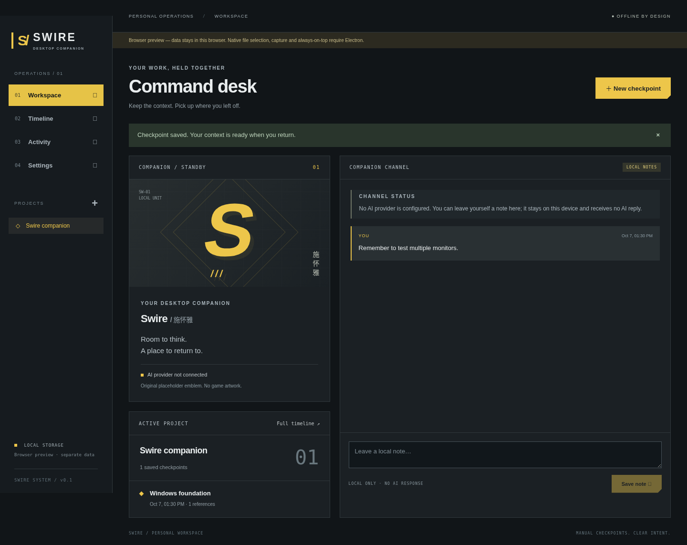
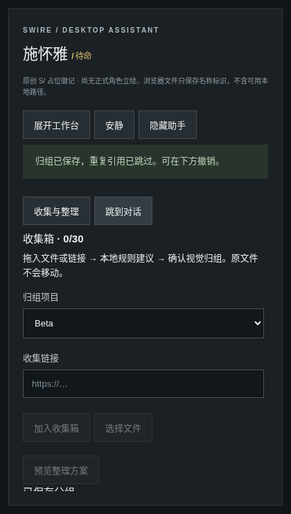

# Swire / 施怀雅

A Windows desktop companion with a small interaction window, explicit AI chat and a local reference organizer, alongside the original workbench. Original dark tactical panels, geometric framing and restrained yellow accents evoke the requested Arknights/Endfield direction without copying either game's interface or artwork. The emblem is an original CSS placeholder.



## Dependency security status

The 2026-11-02 packaging migration removes the remaining vulnerable dependency chain: the full npm audit reports **zero findings**, without exclusions or overrides. See the [final audit, packaging changes and validation limits](docs/security/2026-11-02-packaging-migration.md). This is not a guarantee against unknown vulnerabilities; Windows installation acceptance remains separate.

## Run on Windows

Use Windows 10/11 x64 and Node.js 22.12+ (Node 24 LTS recommended), with npm. From the repository in PowerShell:

```powershell
npm ci
npm run runtime:install
.\node_modules\.bin\electron.cmd --version # expected v44.10.1
npm run dev
```

The development command compiles the Electron main/preload processes, starts Vite on `127.0.0.1:5173`, then launches Electron. Renderer edits update live; restart the command after main/preload edits. The Electron download comes from its official GitHub releases. The npm package does not automatically install the runtime in this version; `npm run runtime:install` does that explicitly. If your environment requires a configured HTTP(S) proxy, set `$env:ELECTRON_GET_USE_PROXY = 'true'` before the download; do not disable TLS or checksum checks. Do not disable application sandboxing on Windows.

Run the production build locally:

```powershell
npm run build
npm start
```

Create a local, unsigned Windows x64 NSIS installer. Install [NSIS 3](https://nsis.sourceforge.io/Download) separately, then put `makensis.exe` on PATH or set `SWIRE_MAKENSIS` to its full executable path (for example `C:\Program Files (x86)\NSIS\makensis.exe`). This command downloads the matching official Electron archive with checksum verification; it never publishes:

```powershell
npm run dist:win
```

Each build creates a fresh `release/win-*/` folder containing `Swire-0.1.0-Setup.exe`, the unpacked `Swire-win32-x64/` app and a relative-path manifest. To produce only the unpacked app, use `npm run pack:win` (no NSIS required). Downloads may use `SWIRE_ELECTRON_CACHE` as an optional cache directory.

The installer targets the current user and a new or empty directory. **Uninstall an older version first**, including any earlier electron-builder build; saved AppData is retained. Uninstall deletes only shipped files, preserving user-added files. Close Swire before uninstalling; locked files require retry. NSIS compilation has been validated on Linux against a real Windows payload; Windows installation/launch/uninstall checks are still required. Code signing, auto-update, startup registration and publication are not included. The executable retains Electron's stock icon/PE metadata. No command publishes or deploys anything.

For UI development without Electron, `npm run dev:web` opens a browser preview at http://127.0.0.1:5173. Browser preview data uses a separate localStorage database; it is not synchronized to desktop data. Native features are visibly disabled.

## Phase 1 companion (2026-11-02)

Use **S/ 施怀雅 · 对话与收集** at the bottom right to open the assistant. **桌面小窗** switches the native window to 420×740; **展开工作台** restores its previous bounds and the original workbench. The existing Settings / always-on-top option controls whether it stays above other apps. **隐藏到任务栏** minimizes it; restore it from the taskbar. Closing the native window exits the app. No tray agent, automatic startup or background monitoring is installed. Browser preview simulates the layout only.



[AI composer preview (unconfigured)](docs/assistant-chat-preview.png)

- Drag files or HTTP(S) links onto the assistant launcher/panel, paste a link, or use native file selection. Only references are stored; file contents are never read. Browser file drops retain name/size/date identifiers, **not usable filesystem paths**. Each pending batch holds at most 30 unique references; extra items are omitted. Remove unwanted items before previewing.
- Choose a project, preview local extension-based group suggestions, optionally edit group names, then **确认归组**. Switching the target project invalidates the preview. Cancel leaves the collected draft available. Confirmation skips references already saved to that project; a repeated operation ID cannot duplicate a batch. **撤销这批归组** removes that batch's metadata only. Paths are never moved, renamed, opened or deleted.
- The assistant's status reflects pending AI requests, local saves, confirmation or idle state. Quiet mode suppresses conversational guidance; no sound or proactive notifications are implemented. Navigation and minimize preserve drafts in memory; closing/reloading discards unsaved drafts and AI conversation.
- AI chat sends only the text explicitly submitted in its composer, not earlier messages, project state, collected references or file contents. Replies are rendered as plain text, cannot run commands, and are kept only in the current window (last 40 messages). Local notebook messages remain separate and persistent.

### Configure AI in the desktop main process

This build supports a non-streaming **OpenAI-compatible chat completions HTTP contract** (`model`, `messages`; response `choices[0].message.content`). It does not call any provider until you press **发送给 AI**. No provider, account, key or paid request is bundled or configured by development/testing.

Set these environment variables **before launching Swire**, then restart it:

- `SWIRE_AI_ENDPOINT`: the complete chat-completions URL, including its path. HTTPS is required except for HTTP on `localhost`, `127.0.0.1` or `[::1]`. URL credentials, query parameters and fragments are rejected. Redirects are rejected.
- `SWIRE_AI_MODEL`: your provider's model identifier.
- `SWIRE_AI_KEY`: optional Bearer credential, supplied to the main process by your own launch environment. Never put it in repository files, screenshots or shared command history. There is deliberately no renderer key field or key readback IPC.

For an **already running local compatible server**, a PowerShell example (replace the model identifier with the one you actually run):

```powershell
$env:SWIRE_AI_ENDPOINT = 'http://127.0.0.1:1234/v1/chat/completions'
$env:SWIRE_AI_MODEL = 'your-local-model-id'
npm run dev
```

This example does not install or start a model. Configuration presence does not prove connectivity; the assistant displays the destination/model before sending. Missing/invalid configuration disables sending. Provider failures use generic errors without response bodies or credentials; requests have a 60-second timeout, explicit cancellation, a 256 KB response-body limit and a 16,000-character reply limit. Failed/cancelled requests retain the input for retry; cancelled late replies are discarded. Cancelling cannot retract text already received by a provider. The main process holds the key in memory; this is **not** an OS credential vault. For an installed build, launch it from the configured environment; changing variables after launch requires a restart.

## Working features

- Create named projects and switch between their checkpoint timelines.
- Manually save checkpoints with titles, notes, and up to 30 selected resource references. Native file selection records paths only; it does not read the files. Typed paths/URLs are plain text and are not automatically opened.
- An explicit screen capture button requests one still preview per screen. Select a preview, remove it, cancel, or save it with a checkpoint. There is no monitoring, stream, scheduled capture, audio or automatic upload. Previews are bounded by Electron's requested 1600×1000 thumbnail size, not full-resolution archival screenshots; actual dimensions vary by display scaling.
- Selected screenshots are written only when saving the checkpoint and can be viewed from the timeline. Unsaved captures are cleared on cancellation, navigation, window close or after ten minutes. Cancelling the capture picker preserves the checkpoint draft; closing the whole checkpoint dialog discards the draft.
- The workbench companion channel saves personal notes, explicitly marked **LOCAL NOTES**. It does not generate or fabricate assistant replies. Recent 1,000 notes are retained.
- Customize the companion's name, compact spacing and native always-on-top behavior.
- View the latest 500 successful save actions in the activity log.
- Validated local persistence, atomic state replacement, a previous-state backup and visible storage error handling. Unsaved form drafts are not persisted.

The character uses an original placeholder emblem, not official artwork or an animated avatar. Credential-vault integration, deletion/editing of saved checkpoints, search, encryption, synchronization, cleanup and performance diagnosis remain future work. AI configuration and explicit text submission are required before any provider request.

## Storage, backup and recovery

Desktop state is under Electron's `app.getPath('userData')`: normally `%APPDATA%\Swire` on Windows. Development builds may use `%APPDATA%\swire-desktop-assistant`, depending on Electron's application path resolution. Files:

- `state.json`: versioned projects, checkpoints, notes, settings, reference-group batches and bounded activity history. Existing v1 data loads with an empty collection list; unknown versions still fail closed. Back up before upgrading: older builds do not understand collection metadata and must not write the upgraded store.
- `state.json.bak`: state immediately before the most recent successful write (not a complete backup history).
- `captures/`: locally saved PNG images referenced by checkpoints.

Close Swire and copy the whole folder to back up, including `captures/`. To restore, close the app and replace the folder with your backup. If `state.json` is unreadable or fails schema validation, the app shows an error and refuses to silently reset it. Preserve the failing file first, then replace it with a known-good backup or `state.json.bak`, and relaunch. Do not edit state files while the app is running. To intentionally reset all data, back up and remove the folder while Swire is closed. Browser preview data can be reset through the browser's site-storage controls.

Local data is not encrypted. References can expose paths and captures can contain sensitive content. Review images before saving. Only manually submitted AI text is sent to the explicitly configured provider by the main process. Production renderer network requests remain blocked. Development mode permits only the local Vite endpoint. Dependency installation and packaging may download tooling, but those operations do not involve saved user content.

## Architecture

- `src/Assistant.tsx`: companion window controls, drop collection, editable previews, confirmation/undo and AI chat UI.
- `scripts/package-windows.mjs`, `packaging/windows.nsi`: verified runtime download, explicit runtime staging and per-user installer with precise uninstall manifest; replaces electron-builder.
- `electron/provider.ts`: main-process provider configuration, bounded HTTP response parsing and generic failure messages.
- `src/main.tsx`, `src/style.css`: React UI and original visual system. Native dialogs trap focus, support Escape and preserve drafts after save failures.
- `src/model.ts`: Zod schemas, limits, immutable state transitions and the narrow bridge contract. State uses format version 1; unknown versions fail closed instead of being overwritten.
- `src/api.ts`: desktop bridge selection and explicitly labeled browser-only persistence adapter.
- `electron/main.ts`: native window, validated IPC sender, serialized mutations, file picker, explicit capture lifecycle and network/permission denial. Only the app's main frame may call IPC. User-controlled paths never get passed to a shell.
- `electron/preload.ts`: a fixed set of contextBridge methods, no raw IPC exposure. Node integration is off; context isolation and renderer sandbox are on.
- `electron/store.ts`: schema-checked JSON persistence through a temporary file, backup and rename. This is a small single-user store, not an encrypted database or multi-process synchronization layer. The application takes a single-instance lock.
- `tests/`: model/store tests and browser interaction tests, including a clearly simulated desktop-bridge capture contract test.

Security choices follow [Electron's security checklist](https://www.electronjs.org/docs/latest/tutorial/security/); capture uses the official [desktopCapturer API](https://www.electronjs.org/docs/latest/api/desktop-capturer).

## Validation

```powershell
npm run format:check
npm run build
npm test
npx playwright install chromium
npm run test:ui
```

`build` includes strict TypeScript checks for both renderer and main process. Unit tests cover model/store behavior, legacy migration, duplicate grouping, project isolation, undo, provider configuration, request payloads, errors, oversized responses and cancellation using mock HTTP calls. UI tests cover the original workbench plus file/link drops, preview cancellation, project switching, grouping persistence/undo, a narrow companion screenshot and simulated AI failure/cancel/retry. No real provider or paid model is contacted. The capture-contract test injects a simulated desktop bridge; it does **not** verify Electron IPC or screen capture.

In a Linux environment with Chromium already installed:

```sh
CHROMIUM_PATH=/usr/bin/chromium npm run test:ui
```

The optional `CHROMIUM_PATH` test override uses `--no-sandbox` for restricted CI browsers only. It never changes the desktop application's sandbox configuration. Screenshots are generated under ignored `test-results/`.

The 2026-11-02 local delivery review passed **11 unit tests and 8 Chromium browser tests**, formatting and the production build. Additional tests verify legacy on-disk backup/reload, cross-project undo without changing referenced files, and explicit AI text isolation from saved notes, paths and dropped-file contents using a simulated bridge. This is not a Windows native or real-provider test.

### Windows acceptance checklist — still required

1. Run the production app with `npm run build` and `npm start`. Confirm it identifies as desktop, not browser preview; create projects, local notes and checkpoints, restart and verify persistence.
2. Select a real file, cancel the picker, select multiple files and verify only names/paths are stored. Test non-ASCII names and Windows paths with spaces.
3. With two displays and mixed DPI scaling, preview capture, inspect both images, cancel and confirm no PNG was written. Preview again, select one image, save and view it after restart. Verify removal, expiry, permissions/unavailable-screen errors and no background capture. OS-protected content may yield blank previews.
4. Toggle always-on-top and restart. Verify focus, minimize/restore, resizing at 100%, 125%, 150% and 200% scaling, keyboard traversal, Escape and the native titlebar. Launch twice and confirm the original window is focused.
5. Exercise a read-only/full storage location and corrupted state. Verify clear errors, preserved drafts and backup recovery, without resetting existing data.
6. In the companion, switch to the small window and back, minimize/restore from the taskbar, and test always-on-top with mixed-DPI displays. Drop actual files (including non-ASCII names) and links; confirm metadata grouping, duplicate suppression, cancellation and undo. Configure an explicitly selected local/test provider, verify the displayed destination, send synthetic text, cancel, and exercise offline/timeout errors. Inspect that credentials never appear in renderer state or logs. These native paths have not been executed in the Linux browser run.
7. Build/install the NSIS output as a standard user, launch it offline, verify desktop IPC and capture again, and test upgrade/uninstall behavior. An installer has been compiled on Linux; it has not been executed on Windows. Test new/empty/nonempty directories, linked-directory rejection, locked files during uninstall, and retention of user-added files and AppData.

Linux/browser checks cannot establish Windows capture, always-on-top, installer, display scaling or native integration correctness.
